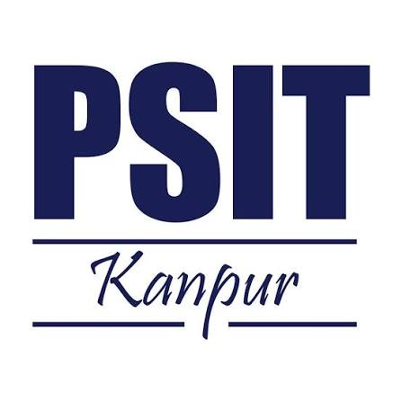

# PSIT-College of Higher Education
**Kanpur-Delhi National Highway (NH-19), Bhauti, Kanpur-209305 (U.P.), India**  
**DEPARTMENT OF COMPUTER APPLICATIONS**

---

# Minor Project (2026-2027)
## PROGRESS DIARY (BCA-5005)

### **AlgoLenz: Interactive Data Structures, Pathfinding & Sorting Visualization Platform**

**Submitted by:**
1. **Naitik** — Roll No: `24116002322`
2. **Kashish Gupta** — Roll No: `24116002274`
3. **Naitik Mishra** — Roll No: `24116002324`
4. **Khushboo Rajpoot** — Roll No: `24116002277`

**Project Id:** `BCA-2026-MP-042`  
**Supervisor:** **Dr. Amit Yadav** *(Professor, Department of Computer Applications)*

  

---

\newpage

# Inner Title Page

### **AlgoLenz: Interactive Data Structures, Pathfinding & Sorting Visualization Platform**

A Report submitted in partial fulfillment of the requirement for the degree of  
**BACHELOR OF COMPUTER APPLICATIONS (BCA)**

**Under the Supervision of:**  
**Dr. Amit Yadav**  
*(Professor, Department of Computer Applications)*

**Submitted By:**  
- **Naitik** (Roll No: `24116002322`)  
- **Kashish Gupta** (Roll No: `24116002274`)  
- **Naitik Mishra** (Roll No: `24116002324`)  
- **Khushboo Rajpoot** (Roll No: `24116002277`)  

**PSIT College of Higher Education, Kanpur**  
**Affiliated to C.S.J.M. University, Kanpur**

---

\newpage

# DECLARATION

We hereby declare that the work presented in this report entitled **“AlgoLenz: Interactive Data Structures, Pathfinding & Sorting Visualization Platform”**, was carried out by us. We have not submitted the matter embodied in this report for the award of any other degree or diploma of any other University or Institute.

We have given due credit to the original authors/sources for all the words, ideas, diagrams, graphics, computer programs, experiments, results, that are not our original contribution. We have used quotation marks to identify verbatim sentences and given credit to the original authors/sources.

We affirm that no portion of our work is plagiarized, and the experiments and results reported in the report are not manipulated. In the event of a complaint of plagiarism and the manipulation of the experiments and results, we shall be fully responsible and answerable.

| S.No | Student Name | Roll Number | Signature |
| :--- | :--- | :--- | :--- |
| 1 | Naitik | 24116002322 | ____________________ |
| 2 | Kashish Gupta | 24116002274 | ____________________ |
| 3 | Naitik Mishra | 24116002324 | ____________________ |
| 4 | Khushboo Rajpoot | 24116002277 | ____________________ |

---

\newpage

# CERTIFICATE

This is to certify that Project Report entitled **“AlgoLenz: Interactive Data Structures, Pathfinding & Sorting Visualization Platform”** which is submitted by **Naitik, Kashish Gupta, Naitik Mishra, and Khushboo Rajpoot** in partial fulfillment of the requirement for the award of degree **B.C.A** of **PSIT-College Of Higher Education**, affiliated to **C.S.J.M. University, Kanpur** is a record of the candidates' own work carried out by them under my/our supervision. The project embodies result of original work and studies carried out by the students themselves and the contents of the project do not form the basis for the award of any other degree to the candidate or to anybody else.

   

**Signature:** __________________________  
**Dr. Amit Yadav**  
*(Supervisor, Professor)*  
Department of Computer Applications  
PSIT College of Higher Education, Kanpur  

  

**Signature:** __________________________  
**Head of Department (HOD)**  
Department of Computer Applications  
PSIT College of Higher Education, Kanpur  

---

\newpage

# ABSTRACT

*(Formatting Guidelines: Heading Font Size: 14pt, Content Font Size: 12pt, Font Name: Times New Roman, Line Spacing: 1.5, Alignment: Justified)*

In contemporary computer science pedagogy, students frequently encounter cognitive friction when attempting to bridge the conceptual gap between theoretical pseudocode and dynamic runtime algorithmic behavior. Abstract notions such as priority queue node relaxations, heuristic evaluations, array partitioning, and recursive backtracking remain difficult to comprehend using static 2D textbook diagrams. To resolve this instructional bottleneck, this project introduces **AlgoLenz**, an interactive, high-performance web-based algorithm visualization and telemetry benchmarking platform inspired by pedagogical environments like VisuAlgo.

AlgoLenz provides an end-to-end multi-paradigm simulation suite developed with React 18, TypeScript 5, Vite, and Tailwind CSS. The platform is structured around five core modules: (1) an **Interactive 2D Grid Pathfinding Visualizer** that simulates Dijkstra’s algorithm, A* search, Breadth-First Search (BFS), Depth-First Search (DFS), and Bellman-Ford across weighted grids, custom terrain weights, and procedural mazes (Recursive Division and Random Walls); (2) a **Geospatial Map Routing Engine** integrated with Leaflet.js that executes shortest path algorithms on real-world road networks and geographical coordinates; (3) a **Multi-Stop Traveling Salesperson Problem (TSP) Optimizer** modeling realistic delivery dispatch heuristics across distributed waypoints; (4) a **Comparative Arena** that executes dual algorithms concurrently under identical input conditions to evaluate time complexity, nodes explored, and path lengths; and (5) an **Audio-Visual Sorting Engine** visualizing Bubble, Selection, Insertion, Merge, Quick, and Heap Sort with real-time audio frequency synthesis generated through the Web Audio API to mirror element swaps and partition boundaries.

Architected with a decoupled state machine powered by the React Context API, AlgoLenz features bidirectional playback controls (step-forward, step-backward, pause, speed throttle) and synchronized code inspectors highlighting active lines of code in real time. The resulting platform delivers an accessible, production-ready educational tool that significantly improves student comprehension of computational complexity, graph theory, and sorting efficiency.

---

\newpage

# Minor Project Timeline / Schedule (Odd Sem 2026-2027)

| Activity | Deadline | Person In-Charge | Document / Form | Status |
| :--- | :--- | :--- | :--- | :--- |
| **Title / Group Formation / Supervisor Allocation** | Till 24th July 2026 | Supervisor / Group Leader | Project Proposal | Completed |
| **Proposal Submission** | Till 14th Aug 2026 | Supervisor / DPC | Project Proposal | Completed |
| **Progress Evaluation 1** | During CT-I | DPC / Evaluators | PowerPoint Presentation / Synopsis | Completed |
| **Weekly Performance Monitoring** | Throughout Semester | Supervisor | Project Diary | Maintained |
| **Progress Evaluation 2** | During CT-II | DPC / Evaluators | PowerPoint Presentation | Completed |
| **End Semester Report & Final Evaluation** | During PU | Supervisor | Project Diary / PPT / Code Demo | Ready |

---

\newpage

# WEEKLY PROGRESS LOGS (WEEKS 1 TO 10)

---

## WEEK 1: Progress Sheet
**Subject Code:** BCA 5005 &nbsp;&nbsp;|&nbsp;&nbsp; **Group Id:** BCA-2026-MP-042  
**Meeting Date:** 01/08/2026 &nbsp;&nbsp;|&nbsp;&nbsp; **Session:** 2026–2027 (Odd Semester)

### Attendance
| S.No | Roll Number | Student Name | Status on Meeting Date (Present /Absent) | Student Signature |
| :--- | :--- | :--- | :--- | :--- |
| 1 | 24116002322 | Naitik | | ____________________ |
| 2 | 24116002274 | Kashish Gupta | | ____________________ |
| 3 | 24116002324 | Naitik Mishra | | ____________________ |
| 4 | 24116002277 | Khushboo Rajpoot | | ____________________ |

**Project Title :** AlgoLenz: Interactive Data Structures, Pathfinding & Sorting Visualization Platform  
**Name of Project Supervisor:** Dr. Amit Yadav  

### Work done in current Week:
        

### Work to be done in next Week :
      

### Supervisor Comments:
    

**Supervisor Signature/Date:** ....................................................

---

\newpage

## WEEK 2: Progress Sheet
**Subject Code:** BCA 5005 &nbsp;&nbsp;|&nbsp;&nbsp; **Group Id:** BCA-2026-MP-042  
**Meeting Date:** 08/08/2026 &nbsp;&nbsp;|&nbsp;&nbsp; **Session:** 2026–2027 (Odd Semester)

### Attendance
| S.No | Roll Number | Student Name | Status on Meeting Date (Present /Absent) | Student Signature |
| :--- | :--- | :--- | :--- | :--- |
| 1 | 24116002322 | Naitik | | ____________________ |
| 2 | 24116002274 | Kashish Gupta | | ____________________ |
| 3 | 24116002324 | Naitik Mishra | | ____________________ |
| 4 | 24116002277 | Khushboo Rajpoot | | ____________________ |

**Project Title :** AlgoLenz: Interactive Data Structures, Pathfinding & Sorting Visualization Platform  
**Name of Project Supervisor:** Dr. Amit Yadav  

### Work done in current Week:
        

### Work to be done in next Week :
      

### Supervisor Comments:
    

**Supervisor Signature/Date:** ....................................................

---

\newpage

## WEEK 3: Progress Sheet
**Subject Code:** BCA 5005 &nbsp;&nbsp;|&nbsp;&nbsp; **Group Id:** BCA-2026-MP-042  
**Meeting Date:** 16/08/2026 &nbsp;&nbsp;|&nbsp;&nbsp; **Session:** 2026–2027 (Odd Semester)

### Attendance
| S.No | Roll Number | Student Name | Status on Meeting Date (Present /Absent) | Student Signature |
| :--- | :--- | :--- | :--- | :--- |
| 1 | 24116002322 | Naitik | | ____________________ |
| 2 | 24116002274 | Kashish Gupta | | ____________________ |
| 3 | 24116002324 | Naitik Mishra | | ____________________ |
| 4 | 24116002277 | Khushboo Rajpoot | | ____________________ |

**Project Title :** AlgoLenz: Interactive Data Structures, Pathfinding & Sorting Visualization Platform  
**Name of Project Supervisor:** Dr. Amit Yadav  

### Work done in current Week:
        

### Work to be done in next Week :
      

### Supervisor Comments:
    

**Supervisor Signature/Date:** ....................................................

---

\newpage

## WEEK 4: Progress Sheet
**Subject Code:** BCA 5005 &nbsp;&nbsp;|&nbsp;&nbsp; **Group Id:** BCA-2026-MP-042  
**Meeting Date:** 22/08/2026 &nbsp;&nbsp;|&nbsp;&nbsp; **Session:** 2026–2027 (Odd Semester)

### Attendance
| S.No | Roll Number | Student Name | Status on Meeting Date (Present /Absent) | Student Signature |
| :--- | :--- | :--- | :--- | :--- |
| 1 | 24116002322 | Naitik | | ____________________ |
| 2 | 24116002274 | Kashish Gupta | | ____________________ |
| 3 | 24116002324 | Naitik Mishra | | ____________________ |
| 4 | 24116002277 | Khushboo Rajpoot | | ____________________ |

**Project Title :** AlgoLenz: Interactive Data Structures, Pathfinding & Sorting Visualization Platform  
**Name of Project Supervisor:** Dr. Amit Yadav  

### Work done in current Week:
        

### Work to be done in next Week :
      

### Supervisor Comments:
    

**Supervisor Signature/Date:** ....................................................

---

\newpage

## WEEK 5: Progress Sheet
**Subject Code:** BCA 5005 &nbsp;&nbsp;|&nbsp;&nbsp; **Group Id:** BCA-2026-MP-042  
**Meeting Date:** 29/08/2026 &nbsp;&nbsp;|&nbsp;&nbsp; **Session:** 2026–2027 (Odd Semester)

### Attendance
| S.No | Roll Number | Student Name | Status on Meeting Date (Present /Absent) | Student Signature |
| :--- | :--- | :--- | :--- | :--- |
| 1 | 24116002322 | Naitik | | ____________________ |
| 2 | 24116002274 | Kashish Gupta | | ____________________ |
| 3 | 24116002324 | Naitik Mishra | | ____________________ |
| 4 | 24116002277 | Khushboo Rajpoot | | ____________________ |

**Project Title :** AlgoLenz: Interactive Data Structures, Pathfinding & Sorting Visualization Platform  
**Name of Project Supervisor:** Dr. Amit Yadav  

### Work done in current Week:
        

### Work to be done in next Week :
      

### Supervisor Comments:
    

**Supervisor Signature/Date:** ....................................................

---

\newpage

## WEEK 6: Progress Sheet
**Subject Code:** BCA 5005 &nbsp;&nbsp;|&nbsp;&nbsp; **Group Id:** BCA-2026-MP-042  
**Meeting Date:** 05/09/2026 &nbsp;&nbsp;|&nbsp;&nbsp; **Session:** 2026–2027 (Odd Semester)

### Attendance
| S.No | Roll Number | Student Name | Status on Meeting Date (Present /Absent) | Student Signature |
| :--- | :--- | :--- | :--- | :--- |
| 1 | 24116002322 | Naitik | | ____________________ |
| 2 | 24116002274 | Kashish Gupta | | ____________________ |
| 3 | 24116002324 | Naitik Mishra | | ____________________ |
| 4 | 24116002277 | Khushboo Rajpoot | | ____________________ |

**Project Title :** AlgoLenz: Interactive Data Structures, Pathfinding & Sorting Visualization Platform  
**Name of Project Supervisor:** Dr. Amit Yadav  

### Work done in current Week:
        

### Work to be done in next Week :
      

### Supervisor Comments:
    

**Supervisor Signature/Date:** ....................................................

---

\newpage

## WEEK 7: Progress Sheet
**Subject Code:** BCA 5005 &nbsp;&nbsp;|&nbsp;&nbsp; **Group Id:** BCA-2026-MP-042  
**Meeting Date:** 12/09/2026 &nbsp;&nbsp;|&nbsp;&nbsp; **Session:** 2026–2027 (Odd Semester)

### Attendance
| S.No | Roll Number | Student Name | Status on Meeting Date (Present /Absent) | Student Signature |
| :--- | :--- | :--- | :--- | :--- |
| 1 | 24116002322 | Naitik | | ____________________ |
| 2 | 24116002274 | Kashish Gupta | | ____________________ |
| 3 | 24116002324 | Naitik Mishra | | ____________________ |
| 4 | 24116002277 | Khushboo Rajpoot | | ____________________ |

**Project Title :** AlgoLenz: Interactive Data Structures, Pathfinding & Sorting Visualization Platform  
**Name of Project Supervisor:** Dr. Amit Yadav  

### Work done in current Week:
        

### Work to be done in next Week :
      

### Supervisor Comments:
    

**Supervisor Signature/Date:** ....................................................

---

\newpage

## WEEK 8: Progress Sheet
**Subject Code:** BCA 5005 &nbsp;&nbsp;|&nbsp;&nbsp; **Group Id:** BCA-2026-MP-042  
**Meeting Date:** 19/09/2026 &nbsp;&nbsp;|&nbsp;&nbsp; **Session:** 2026–2027 (Odd Semester)

### Attendance
| S.No | Roll Number | Student Name | Status on Meeting Date (Present /Absent) | Student Signature |
| :--- | :--- | :--- | :--- | :--- |
| 1 | 24116002322 | Naitik | | ____________________ |
| 2 | 24116002274 | Kashish Gupta | | ____________________ |
| 3 | 24116002324 | Naitik Mishra | | ____________________ |
| 4 | 24116002277 | Khushboo Rajpoot | | ____________________ |

**Project Title :** AlgoLenz: Interactive Data Structures, Pathfinding & Sorting Visualization Platform  
**Name of Project Supervisor:** Dr. Amit Yadav  

### Work done in current Week:
        

### Work to be done in next Week :
      

### Supervisor Comments:
    

**Supervisor Signature/Date:** ....................................................

---

\newpage

## WEEK 9: Progress Sheet
**Subject Code:** BCA 5005 &nbsp;&nbsp;|&nbsp;&nbsp; **Group Id:** BCA-2026-MP-042  
**Meeting Date:** 26/09/2026 &nbsp;&nbsp;|&nbsp;&nbsp; **Session:** 2026–2027 (Odd Semester)

### Attendance
| S.No | Roll Number | Student Name | Status on Meeting Date (Present /Absent) | Student Signature |
| :--- | :--- | :--- | :--- | :--- |
| 1 | 24116002322 | Naitik | | ____________________ |
| 2 | 24116002274 | Kashish Gupta | | ____________________ |
| 3 | 24116002324 | Naitik Mishra | | ____________________ |
| 4 | 24116002277 | Khushboo Rajpoot | | ____________________ |

**Project Title :** AlgoLenz: Interactive Data Structures, Pathfinding & Sorting Visualization Platform  
**Name of Project Supervisor:** Dr. Amit Yadav  

### Work done in current Week:
        

### Work to be done in next Week :
      

### Supervisor Comments:
    

**Supervisor Signature/Date:** ....................................................

---

\newpage

## WEEK 10: Progress Sheet
**Subject Code:** BCA 5005 &nbsp;&nbsp;|&nbsp;&nbsp; **Group Id:** BCA-2026-MP-042  
**Meeting Date:** 03/10/2026 &nbsp;&nbsp;|&nbsp;&nbsp; **Session:** 2026–2027 (Odd Semester)

### Attendance
| S.No | Roll Number | Student Name | Status on Meeting Date (Present /Absent) | Student Signature |
| :--- | :--- | :--- | :--- | :--- |
| 1 | 24116002322 | Naitik | | ____________________ |
| 2 | 24116002274 | Kashish Gupta | | ____________________ |
| 3 | 24116002324 | Naitik Mishra | | ____________________ |
| 4 | 24116002277 | Khushboo Rajpoot | | ____________________ |

**Project Title :** AlgoLenz: Interactive Data Structures, Pathfinding & Sorting Visualization Platform  
**Name of Project Supervisor:** Dr. Amit Yadav  

### Work done in current Week:
        

### Work to be done in next Week :
      

### Supervisor Comments:
    

**Supervisor Signature/Date:** ....................................................

---

\newpage

# SUPERVISOR FINAL EVALUATION SHEET
*(To be filled by Project Supervisor)*

**Project Title:** AlgoLenz: Interactive Data Structures, Pathfinding & Sorting Visualization Platform  
**Project Id:** `BCA-2026-MP-042`

| S.No | Roll No | Name of the Student | Grade by Supervisor |
| :--- | :--- | :--- | :--- |
| 1 | 24116002322 | Naitik | |
| 2 | 24116002274 | Kashish Gupta | |
| 3 | 24116002324 | Naitik Mishra | |
| 4 | 24116002277 | Khushboo Rajpoot | |

**Type of the project (Software/ Software and Hardware/ Simulation or Modelling):** __________________________________________________

**Any other Remark:**  
     

**Supervisor Name and Signature:**  
Dr. Amit Yadav (Professor)  
**Signature:** __________________________ &nbsp;&nbsp;&nbsp;&nbsp;&nbsp;&nbsp;&nbsp;&nbsp; **Date:** _______________  

**Grading Scheme Reference:**  
- **A+**: Outstanding  
- **A**: Excellent  
- **B+**: Good  
- **B**: Average  
- **C**: Not Satisfactory  
